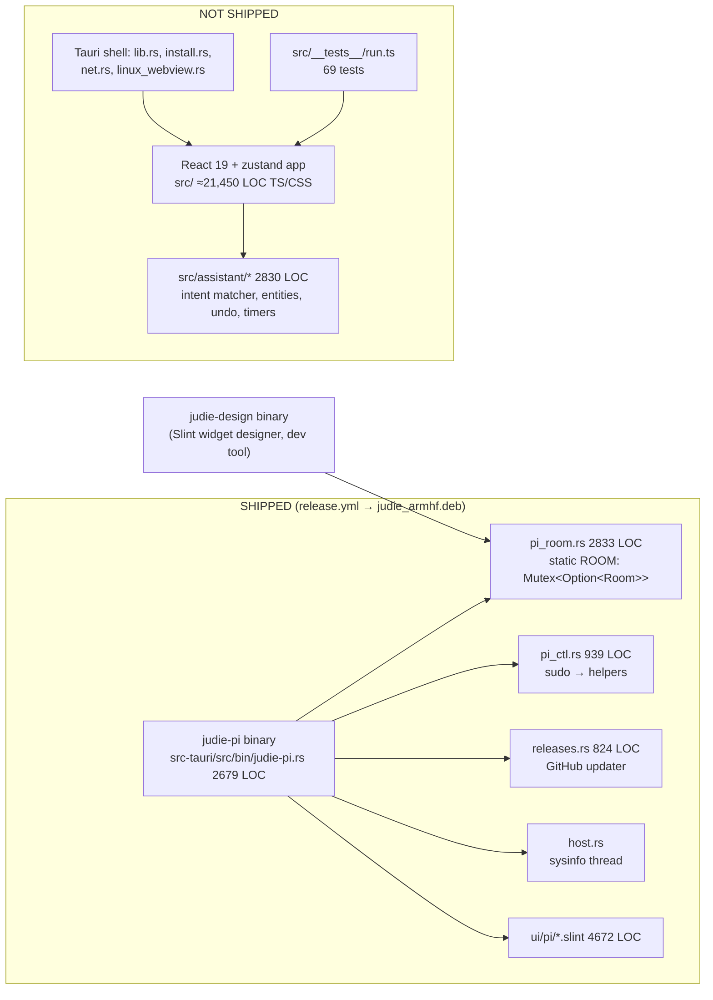
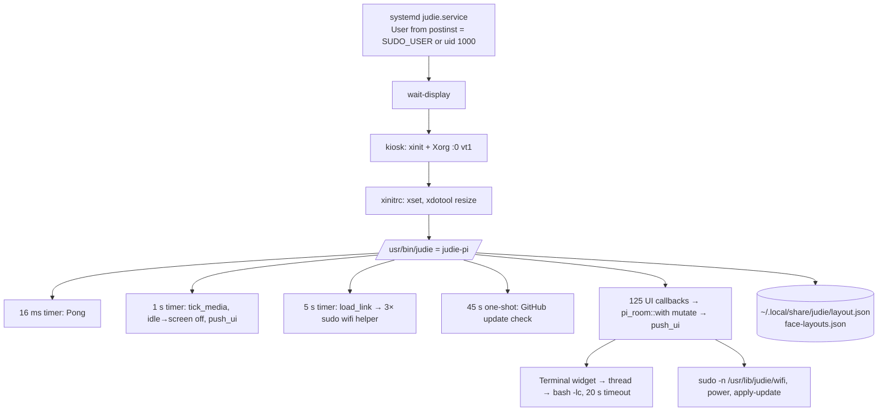
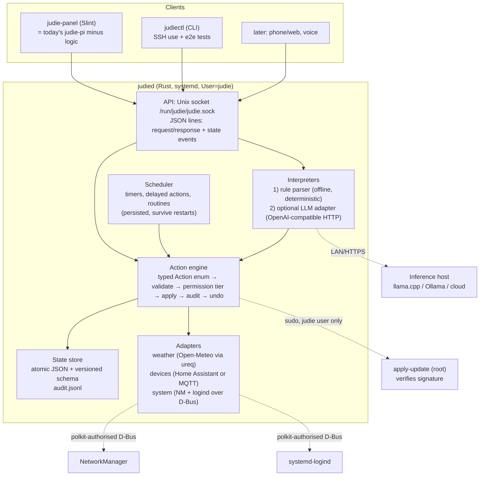

# Judie: Architecture Audit and Redesign Recommendation

Date: 2026-10-30 · Repo state: `main` @ `7dc8ed8` (v0.3.4) · Scope: whole repository, read-only audit

Evidence labels used below:

- **Verified**: I read the code path and confirmed the behaviour, or ran it (the TS test suite).
- **Suspected**: follows from the code, but depends on the device I could not inspect (the Pi's own sudoers, real frame timings).

---

## 0. Your premise is wrong

The brief describes Judie as "an AI project" that "operates primarily through a terminal". The repository says otherwise:

| Brief assumption | What the repository contains |
|---|---|
| AI model integration and inference pipeline | **None.** No model, no LLM client, no inference, no tool calling. The README says: "Judie is a local environment assistant, not a chatbot. Commands are parsed deterministically — no LLM is required." |
| Terminal-bound application | **A full-screen touchscreen kiosk.** A Slint (Rust) UI runs on bare Xorg under systemd on a Raspberry Pi 3B (1 GB RAM, armv7, Raspbian 13 per `plan.md`). The "Terminal" is a widget added in v0.3.1 that runs `bash -lc` from the touchscreen. |
| Memory, context management | A JSON settings file (`~/.local/share/judie/layout.json`). No conversation memory in the shipped build. |
| Tools and system interactions | Real ones: display power, xrandr, Wi-Fi via NetworkManager, reboot/poweroff, self-update, shell. Everything that looks like room control (lights, media, purifier, climate, weather, calendar, timers) is **simulated** with hard-coded data. |

So Phase 5 (AI system evaluation) mostly evaluates a subsystem that doesn't exist yet. I cover it as "what to add and how" (§6), not as a review.

The bigger point: **Judie's real gap isn't intelligence, it's that it controls nothing.** An LLM in front of five fake lights is no more useful than a regex in front of them. The order should be real devices first, then better language, then an LLM.

---

## 1. Current architecture report

### 1.1 Two products in one repo

- `release.yml` builds only `--features pi-native --bin judie-pi`. The React/Tauri app hasn't shipped since Windows support was dropped in v0.2.14. An untracked `build-pi.yml` would still build the Tauri app for aarch64.
- Commits still edit both stacks. For example, `7dc8ed8` touches `SideRail.tsx`, `StatusBar.tsx` and `global.css` alongside `main.slint`.

### 1.2 Runtime on the Pi

### 1.3 Major execution paths

1. **Touch action.** A Slint callback runs `pi_room::with(|room| …mutate…)`, sometimes `room.save()`, then `push_ui()`. `push_ui` rewrites roughly 120 properties and **rebuilds ~15 `VecModel`s from scratch** (`judie-pi.rs:539-873`).
2. **1 Hz tick** (`judie-pi.rs:2561-2585`). It advances fake media progress, puts the display to sleep when idle, and calls `push_ui`. That call spawns `xrandr --current` (`:629`) and `hostname -I` (`:556`, via `pi_ctl::lan_addrs`) **on the UI thread**.
3. **Spoken or typed command** (the "assistant"). Palette text goes to `Room::run_command` (`pi_room.rs:1704-1835`), a first-match chain of `q.contains("…")` checks that ends in a canned reply string.
4. **Terminal widget.** `take_terminal_job` handles `cd` and `clear` itself and sends everything else to a thread running `bash -lc <text>` in the kiosk user's home (`pi_room.rs:782`).
5. **Update.** The GitHub releases API returns a `.deb` URL. The package downloads to `/tmp/judie-update/` and installs via `sudo -n /usr/lib/judie/apply-update` (`apt-get install --allow-downgrades`), the version is checked with `dpkg-query`, and the device reboots.
6. **Wi-Fi and power.** `sudo -n /usr/lib/judie/{wifi,power}` runs shell scripts that call `nmcli`, `iw`, `ip`, `reboot` and `apt-get remove`. Their text output is parsed in Rust.

### 1.4 Capability inventory (shipped build)

| Status | Capability | Evidence |
|---|---|---|
| **Real** | Home grid: pages, drag, resize, add/remove widgets, persistence | `pi_room.rs` slot logic + tests |
| **Real** | Widget creator, custom face layouts, JSON widget import | `pi_room.rs:2092-2318` |
| **Real** | Settings persistence (scales, sidebar, units, screen-off) | `save_persist` `pi_room.rs:516` |
| **Real** | Display sleep (xset, vcgencmd, backlight), xrandr scale/rate | `judie-pi.rs:278-447` |
| **Real** | Wi-Fi scan/connect/forget, DHCP, preferred interface | `pi_ctl.rs` + `linux/wifi` |
| **Real** | Reboot, poweroff, uninstall, self-update with version picker | `pi_ctl.rs`, `releases.rs`, helpers |
| **Real** | CPU, memory, SoC temperature, LAN IP | `host.rs`, `pi_ctl::lan_addrs` |
| **Real** | Shell from the touchscreen, Pong with sound via `aplay` | `pi_room.rs:782`, `judie-pi.rs:227` |
| **Simulated** | Lights (5 fixed IDs), scenes, master brightness/colour | `Room::default` `pi_room.rs:1080-1086`; no I/O anywhere |
| **Simulated** | Media: fixed six-track queue, progress ticks, no audio | `pi_room.rs:1091-1098` |
| **Simulated** | Weather: "Hafnarfjörður 9° Clear", fixed hourly forecast | `pi_room.rs:1103-1117`; no HTTP call in the Pi build |
| **Simulated** | Calendar events, purifier, indoor 21.4°/42% | `pi_room.rs:1118-1127` |
| **Simulated** | Timers: "Tea 3:20", "Laundry 18:00" **never count down** (`remain` is a string that's never updated) | `pi_room.rs:1171-1174` |
| **Fake status** | "Services" panel: `Core 124 ms`, `Lights 6 ms`, … hard-coded | `judie-pi.rs:773-779` |
| **No-op** | "Undo" always answers "Nothing to undo." | `pi_room.rs:1943` |
| **No-op** | Voice-in and speak-replies toggles (no STT/TTS in Rust) | `judie-pi.rs:1523-1536` |
| **No-op** | Assistant URL setting: stored, never contacted, **not persisted** (missing from `Persist`) | `pi_room.rs:963,1130`; `save_persist` |

README features that exist **only in the unshipped React stack**: Open-Meteo weather (`src/lib/weather.ts`), timers, alarms and delayed actions, undo (`roomStore.ts:584-603`), TTS, and the richer intent engine.

---

## 2. Code quality audit

Severity: **Critical** = exploitable or loses data, fix before anything else. **High** = architectural defect with user-visible consequences. **Medium** = real but bounded. **Low** = cosmetic or hygiene.

### Critical

**C1. Any local user can get root through the updater.** *Verified (by reading; not exploited).*

- `src-tauri/linux/sudoers-judie-update:2-4`: `ALL ALL=(root) NOPASSWD: /usr/lib/judie/apply-update` (also `wifi` and `power`).
- `linux/apply-update` accepts any `.deb` under `/tmp/judie-update/` whose package name is `judie` and whose owner equals `$SUDO_UID`. An attacker creates the file, so the attacker's UID is the caller's UID and the owner check passes. **There is no signature check anywhere.** The `Verifying` stage in `releases.rs:500-560` only compares `dpkg-query` versions after installation.
- Consequence: any account on the box, including a compromised service account, can build a package called `judie` with a `postinst` and run it as root. The `power` rule also lets any user uninstall Judie or power off the device.
- Fix (small): restrict the rule to the kiosk user (postinst already knows `KIOSK_USER`) or a `judie` group. Verify a detached signature **inside the root helper** with a pinned key, using `minisign`, or `sha256sum` against a signed `SHA256SUMS`. `src-tauri/keys/nova.key.pub` already exists and is unused on the Pi path.

**C2. The touchscreen Terminal is an unauthenticated shell, and probably a root shell.** *Code verified; root part suspected.*

- `pi_room.rs:782-870` runs arbitrary text via `bash -lc` as the kiosk user. The kiosk user is `SUDO_USER` or uid 1000 (`scripts/package-armhf-deb.sh:69-74`). On Raspberry Pi OS that account normally has `NOPASSWD: ALL` (`/etc/sudoers.d/010_pi-nopasswd`). I could not inspect your Pi's sudoers.
- Consequence: anyone standing at the panel can `sudo` anything. Nothing confirms or logs it.
- Fix: make the widget opt-in and PIN-gated, and run the kiosk as a dedicated user with no sudo beyond the scoped helpers. Better: drop it and use SSH. A wall panel isn't a terminal.

**C3. A power cut can silently reset all settings.** *Verified.*

- `save_persist` (`pi_room.rs:516-555`) uses `std::fs::write`, which truncates and then writes. `load_persist` (`:508-513`) turns any parse error into `Persist::default()` without a log line.
- `on_volume_changed` saves on every slider event (`judie-pi.rs:1315-1321`). That means many SD writes per drag, and a wide window for a torn file.
- Consequence: pulling the plug on a Pi (a routine event) during a save wipes the layout, custom widgets, routines and display settings, with no error shown.
- Fix: write to a temp file, `fsync`, then `rename`. Keep `layout.json.bak`, debounce saves (about 1 s), and log parse failures loudly. About 20 lines.

### High

**H1. Two parallel implementations, and only one ships.** *Verified.*

- About 21,450 lines of React/TS/CSS plus about 490 lines of Tauri Rust don't ship (§1.1), yet they're still co-edited in each release. Features drift between them: the README describes the React feature set, while the Pi runs the Slint one.
- Consequence: development time roughly doubles, docs mislead, and tests give false confidence (H2).
- Fix: **delete** the React/Tauri stack after extracting its utterance test corpus (§7, Stage 1). No rewrite is needed; it's dead weight.

**H2. The test suite mostly doesn't test the shipped product.** *Verified (ran `npm test`: 69/69 pass).*

- `src/__tests__/run.ts` imports TS modules that don't ship. Many "Pi" tests read `.slint`, `.rs`, `.css` and `.sh` files as text and assert substrings (`run.ts:708-1059`; about 290 `includes`/`match` calls).
- Example: "pi network helpers never leak credentials" (`run.ts:1330`) tests `src/lib/piNetwork.ts`, not the `pi_ctl.rs` that actually ships.
- `release.yml` runs **neither** `npm test` nor `cargo test`. The real Rust unit tests in `pi_room.rs:2587+`, `pi_ctl.rs` and `releases.rs` are good but never run in CI.
- Fix: put `cargo test --features pi-native` in CI as a release gate, and delete the source-grep tests along with the React stack.

**H3. Blocking subprocess work on the UI thread.** *Verified that it happens; frame-time impact suspected (not profiled on the device).*

- Every second, `push_ui` spawns `xrandr --current` (`judie-pi.rs:629`) and `hostname -I` (`:556`).
- Every 5 seconds, `load_link` (`:1073-1098`) runs **three** `sudo` invocations of the Wi-Fi helper (`detail`, `dhcp`, `preferred`), and each runs several `nmcli` calls. All of this is synchronous on the Slint event loop.
- Consequence: periodic hitches on a Pi 3. Every `sudo` call is also logged, which spams the journal and costs SD writes forever.
- Fix: one background poller thread that posts changes to the UI with `invoke_from_event_loop`. Cache display info, which only changes when the user acts.

**H4. Every model is rebuilt on every refresh.** *Verified.*

- `push_ui` builds about 15 new `VecModel`s per call (`judie-pi.rs:716-871`), so Slint tears down and re-creates every repeated element. It runs on every tick and after most of the 125 `ui.on_*` callbacks.
- Commit `7dc8ed8` ("stop drag freezes") worked around this by skipping refresh during drags (`:2579-2582`). That treats the symptom, not the cause.
- Fix: keep long-lived models and update rows in place (the code already does this for routines in `patch_routine_row`, `:1012`). Only set properties that changed.

**H5. A god object behind a global mutex.** *Verified.*

- `Room` (`pi_room.rs:937-1018`) has about 80 fields. It mixes domain state (lights, routines), view state (`overlay`, `palette_query`, `gallery_query`, `creator_selected`, `terminal_input`), persistence and process execution.
- It's reached through `static ROOM: Mutex<Option<Room>>` (`:2576`). `judie-pi.rs` is a 2,679-line file with 125 inline `ui.on_*` closures, and `main.slint` is 2,651 lines.
- The mutex isn't re-entrant, so any future nested `pi_room::with` call deadlocks the UI. That's latent; I found no case today.
- Consequence: this is the root reason nothing can run headless (timers, routines, a phone UI). It's also why new features keep growing `push_ui`.
- Fix: a targeted refactor, not a rewrite. See §5.

**H6. The command parser misroutes common phrases.** *Verified by tracing `Room::run_command`, `pi_room.rs:1704-1835`.*

| Input | Result | Cause |
|---|---|---|
| "turn the music off" | **starts playback** | no "pause" or "stop", so `contains("music")` → `playing = true` |
| "turn on the desk light" | all lights on | `light`+`on` branch precedes the `desk` branch |
| "what's on this morning" | runs the Morning routine | `contains("morning")` |
| "dim the lights" | "I heard…" fallback | no brightness handling |
| A custom routine with phrase "night light" | never fires | custom routines are checked only after all built-ins |
| Routine A ("alpha" → "beta") and routine B ("beta" → "alpha") | **unbounded recursion → stack overflow → kiosk crash** | only the self-loop is guarded (`cmd == q`) |

Fix: replace the chain with a small table-driven parser that returns a typed `Action`. Add a recursion depth limit of 3 and port the TS golden utterances (Stage 1).

### Medium

| ID | Finding | Location | Consequence | Fix |
|---|---|---|---|---|
| M1 | The UI shows fabricated data as live: the Services latency panel, a static forecast, and timers that don't count. The README claims "the UI does not pretend to be wired to hardware that is not there" | `judie-pi.rs:773-779`, `pi_room.rs:1103-1174` | You can't trust the panel | Show "not connected" until an adapter exists |
| M2 | Updates trust only TLS to GitHub; `--allow-downgrades` is on; the minisign key is unused | `releases.rs:410-425`, `linux/apply-update` | A compromised release or account means a compromised device | Signature check in the root helper (C1) |
| M3 | Personal and dev defaults are baked into prod code: `HOME` fallback `/home/fannsonetti`; `save_face_layout_file` writes to `./src-tauri/ui/pi/layouts/` whenever the working directory is a repo checkout | `pi_room.rs:443`, `:464-471` | Wrong paths on other machines; prod writes into source trees | Remove; move dev export to `judie-design` |
| M4 | Errors are swallowed: 58 `let _ =` (in `judie-pi.rs` and `pi_room.rs`) on fs writes, xrandr, backlight and saves. No Rust logging after startup | throughout `judie-pi.rs`, `pi_room.rs` | Failures are invisible in `journalctl` | `eprintln!` at minimum (systemd captures it), or the `log` crate |
| M5 | `unsafe { set_var("SLINT_SCALE_FACTOR") }` runs after `host::warm()` has started a thread | `judie-pi.rs:443` vs `:2516` | Formally UB on glibc; it will become a compile error under edition 2024 | Compute the scale before spawning threads, or pass it to Slint directly |
| M6 | Changing display scale restarts the app via `process::exit(0)` and relies on systemd to bring it back | `judie-pi.rs:449-454` | Any in-memory state is lost (today that's only fake state; it won't be once timers are real) | Fine once state lives in a daemon (§5) |
| M7 | `README.md` documents the React feature set and architecture | `README.md` | Misleads you and any future agent | Rewrite after Stage 1 |

### Low / cosmetic (do not prioritise)

- Rebrand leftovers: `nova.key.pub`, the `"nova"` role in `lib.rs:pad_role`, `NOVA_FRAME`. "Slop" naming (`SlopNode`, `slopbox/`) for the widget-layout model.
- `mix_rand` (time plus a counter) generates the "verify" strings (`judie-pi.rs:103-139`). That's fine for an are-you-sure prompt, but it isn't security, and nothing should treat it as such.
- Repo hygiene: untracked `build.bat` and `build-pi.bat` (for an unsupported platform), `graphify-out/` (11 MB including raw framebuffer dumps), `plan.md` (35 KB of agent scratch marked "never commit"), and `screenshots/`.
- Pong in a room controller is a product choice, not a defect. It's cheap and isolated, so keep it.

### What is good, and worth keeping

- **The privileged helpers are carefully written** apart from the sudoers scope. Actions are allow-listed, Wi-Fi passwords go over stdin and never argv, path, name, arch and version are checked, the old package is never removed before the new one installs, the device reboots only after `dpkg-query` confirms the version, and the `KillMode=process` reasoning is documented.
- **Slint with the software renderer, no WebKit, on a 1 GB Pi** is the right call. The release profile (`opt-level=s`, LTO, `panic=abort`) fits it.
- **The Rust unit tests** in `pi_room.rs` (temporary HOME, reload round-trips, editor lifecycle) and the mock seams in `pi_ctl.rs` (`JUDIE_POWER_MOCK`, the mock JSON) are real tests of shipped code.
- **Display bring-up knowledge** (fbdev vs modesetting, `wait-display`, `-nocursor`, DPMS) was paid for in debugging time. Keep it.

---

## 3. Technical debt assessment

| Item | Verdict | Why |
|---|---|---|
| C1 sudoers scope + unsigned updates | **Fix now** | Root escalation. A few lines in two files |
| C2 Terminal widget | **Fix now** (gate or remove) | Physical root shell |
| C3 non-atomic persistence | **Fix now** | Data loss on the most common failure (power) |
| H6 parser bugs + recursion | **Fix now**, minimal | A user-visible crash and wrong actions |
| H2 CI runs no tests | **Fix now** | One workflow step |
| H1 React/Tauri stack | **Delete** (Stage 1) | 22k LOC of drag on every change |
| H3/H4 UI-thread work and model rebuilds | **Fix in refactor** | Needs the state split anyway |
| H5 god object | **Refactor incrementally** | The core logic is salvageable; a rewrite would throw away tested slot and editor code |
| Fake data (M1) | **Fix when adapters land** | Show "not connected" meanwhile |
| Naming (slop/nova), file size of `main.slint` | **Leave** until touched | Cosmetic; renames churn history for no user value |
| Shell helper scripts → D-Bus | **Replace later** (Stage 5) | They work. Replacing them is about structured data, not urgency |

**Rewrite or refactor?** Refactor. The shipped Rust core has working, tested slot, layout and editor logic and hard-won Pi bring-up. The defects are about boundaries (state ownership, the UI thread, privileges), and those can be fixed by moving code, not replacing it. The only thing to discard is the React/Tauri stack, and that's a deletion, not a rewrite.

---

## 4. Future direction comparison

Hardware constraint first. The target is a **Raspberry Pi 3B: 4× Cortex-A53, 1 GB RAM, armv7, software rendering.** Rough estimates, not measured here: a 0.5B-parameter model at 4-bit needs about 0.4 GB and generates a few tokens per second on this CPU. A 1–3B model doesn't fit next to Xorg and the UI. **Local LLM inference on this device isn't a viable interactive feature.** Any AI has to run on another machine (a LAN PC or GPU box running llama.cpp server or Ollama, or a cloud API), or you'd need a hardware upgrade (Pi 5 8 GB: small models only, still slow).

| | A. Improved kiosk app (status quo, cleaned) | B. Linux service + thin clients | C. AI desktop environment | D. Custom distro | E. **B, scoped as an appliance** (recommended) |
|---|---|---|---|---|---|
| Note | "Improved terminal AI" doesn't apply; there is no terminal app | | | | |
| Feasibility | High | High | Low on a Pi 3 (software rendering, 1 GB) | Medium; high ongoing cost | High |
| Dev complexity | Low | Medium (one daemon, one socket protocol) | Very high | High, forever | Medium |
| Hardware | Pi 3 OK | Pi 3 OK (daemon is a few MB) | Needs a far stronger machine | Same as base | Pi 3 OK; optional LAN inference host |
| Latency | Good once H3/H4 are fixed | Same; one local socket hop is about 0.1 ms | Poor on this device | No change | Same as B |
| Maintainability | Better than now, still one process | Clear boundaries, headless tests | Huge surface | You own kernel, firmware and CVEs | Clear boundaries |
| Security | Fixes C1/C2 | Central place for permissions and audit | Large attack surface | Full responsibility for patching | Same as B plus tiered actions |
| Extensibility | UI-bound | Phone, web, CLI, voice become clients | High but costly | None by itself | Same as B |
| Local AI integration | Awkward (the UI process calls the LLM) | Natural (an interpreter adapter in the daemon) | Natural | Irrelevant | Natural, off-device |
| Continuous operation | Stops when the UI restarts | Timers and routines survive UI restarts and crashes | Yes | Irrelevant | Yes |
| Long-term potential | Capped | Good | Speculative | Negative return | Good |

**Why not C:** Judie is a single-purpose wall panel, not a desktop. Building a desktop environment on a Pi 3 means reimplementing what GNOME and KDE already do, on hardware that can't run them well. "Deeper OS integration" here means systemd, NetworkManager, logind and polkit, which §5 uses. It doesn't mean writing a shell.

**Why not D:** a distro makes you responsible for kernel and firmware updates, security patches, drivers, recovery images and an update channel for the whole OS. What you actually want is an **appliance image**: a recipe (`rpi-image-gen`, or a `pi-gen` stage) that bakes Raspberry Pi OS Lite, `judie.deb` and the Xorg config into a flashable image, while still taking Debian's security updates. Your `postinst` already rewrites `/etc/X11` configs. That's appliance behaviour living in the wrong place. Do this last; it's optional.

> **Superseded in part by §9** (cloud assistant, minimum latency, auto-update, premium UI).

**Recommendation (E):** Judie becomes a **room appliance**. One small Rust daemon (`judied`) owns all state, scheduling, device adapters and permissions. The Slint panel and a CLI are clients. The "AI" is a pluggable interpreter that can only emit the same typed, validated actions the touchscreen does. This beats A because it makes timers, routines and real devices survive UI restarts and enables more interfaces. It's far cheaper than C or D. And it puts the LLM behind a hard authorization boundary instead of making it the architecture.

---

## 5. Recommended architecture

Design choices and why:

- **One daemon, not microservices.** Weather, devices, scheduler and engine are modules in one process. The Pi has 1 GB, and there's a single developer.
- **The `Action` enum is the system's spine.** Touch, the rule parser, routines, timers, the CLI and the LLM all produce the same `Action`. Validation, permissions, undo and audit happen once, in `ENG`. This is the abstraction the code is missing today: `Room` methods are called directly from 125 closures and from `run_command`.
- **IPC is a Unix socket with JSON lines.** It's trivial to test (`socat`, `judiectl`) and needs no new framework. File permissions on the socket handle authentication. I'd skip D-Bus for Judie's *own* API, since it adds introspection and bus-policy work for no gain over a socket. Add a token-protected LAN HTTP endpoint only when a phone or web client exists.
- **Use D-Bus where it already exists.** Talk to NetworkManager and logind over D-Bus (the `zbus` crate) with a polkit rule scoped to the `judie` user. That deletes the `wifi` and `power` shell helpers, `sudo` and the `nmcli` text parsing, and it's structured data instead of awk. `apply-update` stays the **only** root helper, now with a signature check.
- **Storage: no database yet.** Keep atomic JSON with a `"version": N` field and migrations, plus append-only `audit.jsonl` with rotation. Move to SQLite only when you need to query history.
- **Devices: integrate, don't implement.** If you run Home Assistant, use its REST/WebSocket API; otherwise MQTT (Zigbee2MQTT, Tasmota). Writing Zigbee or Hue protocol code yourself is wasted effort. *This depends on what hardware you actually own. That's an open question for you.*
- **Interfaces:** the panel stays primary. `judiectl` costs almost nothing once the socket exists, and it's both your "terminal" interface and your end-to-end test harness. Voice comes later: STT on a Pi 3 is impractical, so the audio would go to the inference host.

---

## 6. AI system evaluation

What exists today: a substring if-chain in Rust (shipped), and a more capable TS engine (normalisation, clause splitting, entities, anaphora, durations, context with TTL, undo) that doesn't ship. Neither uses a model.

| Capability | Needed? | How / when |
|---|---|---|
| Local + remote model support | Yes, as **one** OpenAI-compatible HTTP client | llama.cpp server, Ollama and cloud APIs all speak it. Not on the Pi 3 |
| Multiple model configs | Not yet | One `[llm]` config block. Add a list only when you have two real uses |
| Structured tool-call validation | **Essential** | The tool schema is generated from the `Action` enum. LLM output is deserialised with serde; unknown actions and out-of-range values are rejected before the engine sees them |
| Reliable tool execution | Yes | The rule parser runs first, and the LLM is only a fallback for "I didn't understand". Most commands never touch the network |
| Persistent memory | Minimal | Room state snapshot plus the last N audit entries go into the prompt (about 1–2 KB). No vector DB |
| Context compression | No | Interactions are one-shot commands, not long chats |
| Long-running tasks, cancel, recovery | Yes, **for the scheduler**, not the LLM | Persisted timers and delayed actions with IDs, cancellable via the API, re-armed on startup |
| Background operation | Yes | The daemon itself |
| Streaming | No for actions; maybe for spoken replies later | |
| Resource-aware model loading | Not on the Pi | That's the inference host's job (Ollama already does it) |

**Authorization tiers (enforced in the action engine, not in prompts):**

| Tier | Examples | LLM may request? | Confirmation | Audit |
|---|---|---|---|---|
| 0 Read | state, weather, "what's on" | yes | no | no |
| 1 Room | lights, media, scenes, timers | yes | no; undoable | yes |
| 2 System | Wi-Fi change, reboot, update, routine edits | proposes only | **on-panel confirm** | yes |
| 3 Never automated | shell, uninstall, arbitrary commands | **no**, not in the schema | PIN at panel | yes |

**Replace or improve?** Replace the Rust if-chain with a table-driven parser. Don't port the TS engine line by line. Port its **utterance test cases** (`run.ts` calls `processUtterance` 52 times) as a golden corpus of input → expected `Action`. That corpus is the most valuable asset in the React stack: it gates the rule parser and later measures the LLM fallback. **Don't adopt an agent framework.** One request, one validated action list, one execution: there's no planning loop to manage.

---

## 7. Migration roadmap

Each stage ships as a normal `.deb`. **Rollback** is the existing on-device version picker, since `apply-update` allows downgrades. Add a persisted-schema `version` field **before** Stage 2 so older builds refuse newer files instead of silently resetting.

| Stage | Work | Acceptance criteria |
|---|---|---|
| **0. Hotfix** (days) | C1: sudoers → kiosk user or group, signature check in `apply-update`. C2: Terminal widget off by default + PIN. C3: atomic save + `.bak` + debounce. H6: recursion limit, fix the music/desk/morning misroutes. CI: `cargo test --features pi-native` gates the release | `sudo -u nobody sudo -n /usr/lib/judie/apply-update x.deb` is refused; an unsigned `.deb` is refused; a torn `layout.json` loads from `.bak`; new parser tests pass; release blocked on test failure |
| **1. Delete the second product** | Extract the golden utterances from `run.ts` into a Rust test fixture. Delete `src/`, `index.html`, `vite.config.ts`, `package*.json`, `tsconfig*`, the Tauri feature and files (`lib.rs`, `main.rs`, `install.rs`, `net.rs`, `linux_webview.rs`, `tauri*.json`, `capabilities/`), `build-pi.yml`, `build*.bat`, the Playwright scripts. Rewrite the README | Release CI green; repo has no Node toolchain; README matches the shipped features |
| **2. Untangle the panel** | Split `Room` into domain state and view state. Persistent Slint models with in-place updates. One background poller for network, display and host stats. Remove the drag-skip hack | No subprocess spawned on the UI thread (check with `strace -f -e execve` on the main TID); idle CPU measured before and after on the Pi; drag is smooth without the skip |
| **3. Extract `judied`** | Move domain state, scheduler and engine into the daemon. Add the socket API and `judiectl`. The panel becomes a client. Real timers, Open-Meteo weather | Kill the panel, and a timer still fires; `judiectl` e2e tests run in CI without a display; panel restart keeps all state |
| **4. Real devices** | One adapter (Home Assistant or MQTT, your choice). Simulated widgets show "not connected" | The physical light changes from the panel and from `judiectl`; the audit log shows the source |
| **5. System via D-Bus** | NetworkManager and logind via `zbus` + polkit; delete the `wifi` and `power` helpers and their sudoers lines | Wi-Fi and power work with no `sudo` in the process tree; one root helper left |
| **6. Optional LLM fallback** | OpenAI-compatible client, schema from `Action`, tiers enforced, confirmation UI for tier 2 | The golden corpus still passes with the LLM disabled; with it enabled, previously unhandled phrasings succeed and no tier 3 action is ever produced (fuzz with adversarial prompts) |
| **7. Optional image recipe** | `rpi-image-gen` config: OS Lite + Judie + Xorg config; move display config out of `postinst` | Flash, then boot to panel, with no manual steps |

**Preserve / refactor / replace / consolidate / delete:**

- **Preserve:** the privileged-helper validation logic, `releases.rs` install flow, slot/grid/editor logic and its tests, the Slint UI files, Pi display bring-up, the release profile.
- **Refactor:** `Room` (split), `push_ui` (incremental), `judie-pi.rs` (callbacks grouped per feature module).
- **Replace:** the `run_command` if-chain (table-driven parser), the `wifi` and `power` shell helpers (D-Bus, Stage 5), the simulated data (adapters, Stage 4).
- **Consolidate:** two state models and two parsers into one; three sudo helpers into one.
- **Delete:** the React/Tauri stack, source-grep tests, `build-pi.yml`, `build*.bat`, the dev write in `save_face_layout_file`, the hard-coded `/home/fannsonetti`, the fake Services panel.

---

## 8. Immediate priorities (in order)

1. **Scope the sudoers rules to the kiosk user and verify update signatures in the root helper** (C1). This is the only remote-adjacent root path.
2. **Turn the Terminal widget off by default and gate it** (C2).
3. **Atomic, debounced settings writes with a backup** (C3).
4. **Run `cargo test` in the release workflow** (H2). It's one step, and it makes everything after this safer.
5. **Fix the parser recursion crash and the three misroutes** (H6), each with a test.
6. **Delete the React/Tauri stack**, after saving its utterance corpus (H1).
7. **Move subprocess polling off the UI thread** (H3). This is the cheapest visible performance win, and it doesn't wait for the full refactor.

### Open questions that change the plan

- **What physical devices do you have?** Lights, speakers, purifier, sensors, and is Home Assistant already running? Stage 4, and whether Judie is worth an LLM at all, depend on this.
- **Is there a machine on your LAN that could host a model** (a GPU PC, Mac, or server)? If not, the LLM path means a cloud API, which brings privacy and offline trade-offs.
- **Is the Pi 3B the long-term hardware?** A Pi 5 changes the rendering budget, not the architecture.

---

## 9. Revision: updated requirements (2026-10-30)

New requirements from you: **cloud AI**, **a general assistant** (not just room control), **minimum input latency**, **auto-update from GitHub**, and **UI quality on the level of Apple's**.

### 9.1 What changes in the recommendation

| Earlier (§4–§6) | Now |
|---|---|
| Separate `judied` daemon plus a socket API | **One process, two crates.** A `judie-core` library holds state, the action engine, the AI client and the scheduler. The `judie-panel` binary is the Slint UI. Its worker threads talk to the UI over channels and `invoke_from_event_loop`. With no second client on the roadmap, a socket adds a hop and a protocol for no benefit. Splitting later is mechanical because the core is already a library. |
| LLM as an optional fallback interpreter | **The assistant is a first-class feature.** It gets a chat surface, streaming replies and persisted conversations. Room actions are tools the model can call, and they still pass through the `Action` engine and its tiers (§6). |
| "Context compression: no" | **Yes.** General chat runs long. Keep the last N turns verbatim plus a running summary, and send the system prompt and tool schema as a stable prefix so prompt caching cuts cost and time to first token. |
| "Streaming: no" | **Yes, required.** Perceived AI latency is time to the first token, not the full reply. |
| Hardware: Pi 3B is fine | **The Pi 3B is the bottleneck for both latency and visual quality.** See 9.3. |

### 9.2 Where the latency actually is

Optimise in this order. Each item is a larger share of the delay than anything after it.

1. **Rendering.** Slint runs `renderer-software` on 4× Cortex-A53 at 1920×1200, through bare Xorg with fbdev. A full-screen redraw costs whole frames, and any full-screen animation drops below 60 fps.
2. **UI-thread stalls** (H3/H4). Subprocesses run on the event loop, and every model is rebuilt each second. These are pure waste and the first code fix.
3. **Network and the model** (cloud AI). Expect hundreds of milliseconds to the first token. Hide it with streaming, an immediate "thinking" state, and keeping one HTTPS connection alive to the API so TLS setup isn't paid per request.
4. **IPC.** It's negligible (about 0.1 ms), but with one process it disappears anyway.

The rule for the panel: **touch feedback never waits on anything.** Visual state changes in the same frame as the touch. Device, AI and network results arrive asynchronously.

### 9.3 Apple-level UI on this hardware

Design quality comes mostly from design work: typography, spacing, motion curves and consistency. That's achievable in Slint. But the motion that makes Apple's UI feel the way it does (60 fps or faster, blur, layered translucency, spring physics) needs a GPU renderer. **The Pi 3B's software renderer can't deliver that at 1920×1200.**

Recommended platform change:

- **Raspberry Pi 5 (4–8 GB), 64-bit Raspberry Pi OS.**
- **Slint `backend-linuxkms` with the `renderer-femtovg` (OpenGL ES) or Skia renderer.** It draws straight to DRM/KMS with no Xorg, no xinit and no xdotool. That's lower latency, less memory and fewer moving parts than the current `kiosk`/`xinitrc`/fbdev chain.
- Keep Slint. The UI investment carries over, and it's built for exactly this kind of device.

If you stay on the Pi 3B, aim for a calm, mostly static design: crisp type, minimal animation, transitions limited to small regions. That can still look premium, just not with that kind of motion.

### 9.4 Auto-update from GitHub

The mechanism already exists (45 s check, version picker, `apply-update`, reboot). Making it **automatic and unattended** raises the stakes, because a bad release now reaches the device by itself. Required:

1. **Signed releases, verified in the root helper** (C1). This is non-negotiable once installs happen unattended.
2. **CI gate:** `cargo test` must pass before the release job uploads (H2).
3. **Install when idle** (screen asleep, no active conversation). Then `systemctl restart judie` instead of rebooting, which takes seconds instead of a minute.
4. **Automatic rollback:** cache the previous `.deb`. If the new version doesn't report healthy within about 60 s (for example, it writes a `healthy` marker after its first frame), reinstall the previous one. Use a systemd `OnFailure=` unit or a counter in the helper.
5. **Schema migrations** with a `version` field, so a rollback never reads a file it doesn't understand.
6. A **channel setting** (stable/beta) via GitHub prereleases, so you can test on your device first.

### 9.5 Cloud AI specifics

- **Secrets:** store the API key in a `0600` file owned by the kiosk user (for example `~/.config/judie/credentials`). Never put it in `layout.json`, logs or the UI.
- **Model choice:** a fast model for normal chat and tool calls (for example Claude Haiku 5.5). Escalate to a larger model (Claude Sonnet 5.5) only when asked or for long tasks. Keep it configurable.
- **Tools:** generate tool schemas from the `Action` enum. Tiers 0–1 run immediately, tier 2 shows an on-panel confirmation, and tier 3 (shell, uninstall) is never exposed to the model.
- **Offline:** the rule parser still handles room commands with no network, so the lights work when the internet doesn't.
- **Privacy:** conversations leave the house. Show a clear indicator when the assistant is sending data.
- **Persistence:** conversations go in an append-only JSONL file per conversation, with atomic index updates. Still no database until you need search.

### 9.6 Revised roadmap

| Stage | Change from §7 |
|---|---|
| 0. Hotfix | Unchanged. Signed updates are now **mandatory** (they're a precondition for auto-update). |
| 1. Delete the React stack | Unchanged. |
| 2. Untangle the panel | Unchanged, plus a `judie-core` crate split. |
| 3. ~~Extract `judied`~~ → **Assistant v1** | Chat surface, streaming client on a worker thread, tool calls via `Action`, conversation persistence, key storage. Acceptance: first token is visible less than 1 s after send on a normal connection; the UI never stalls while streaming (frame-time log). |
| 4. **Unattended updates** | Idle install, service restart, health check and rollback, beta channel. Acceptance: a deliberately broken beta release rolls itself back without anyone touching the device. |
| 5. **Platform: Pi 5 + linuxkms + GPU renderer** | Delete the Xorg chain (`kiosk`, `xinitrc`, `wait-display`, Xorg configs, the xrandr code). Acceptance: 60 fps during transitions (Slint frame timing), and touch-to-photon latency measured with a high-speed phone camera before and after. |
| 6. Design pass | A design system (type scale, spacing, motion tokens), applied screen by screen. This only pays off after Stage 5. |
| 7. Real devices, D-Bus system integration | The old Stages 4 and 5, now lower priority. |
